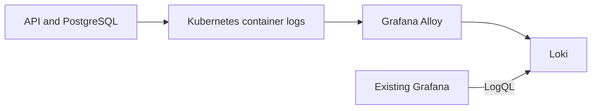

# What the application tells us

English · [Português](README.md)

Metrics help us notice a change. Logs help us investigate what happened. In this lab, logs from the notes API and PostgreSQL reach Loki and become searchable in the Grafana instance from monitoring-lab.

Alloy follows Pods through the Kubernetes API. No node directories are mounted, no privileged container is needed and the application image stays unchanged. Gunicorn already writes HTTP access and error logs to stdout/stderr.



## Run it

Use Docker, Git, Bash and Python 3 on Linux x86_64 or WSL. Clone this repository beside [kubernetes-lab](https://github.com/tommmdl/kubernetes-lab) and [monitoring-lab](https://github.com/tommmdl/monitoring-lab).

For a fresh environment, run `bash scripts/prepare.sh` and `bash scripts/lab.sh up` in Kubernetes lab, then `bash scripts/lab.sh up` in monitoring-lab. Skip preparation if the application and Grafana are already running. Avoid reapplying application manifests after Argo CD has taken over their management.

Here in logging-lab:

```bash
bash scripts/validate.sh
bash scripts/lab.sh up
python3 tests/verify.py
```

Scripts select context `kind-devops-notes` and use Kubernetes lab's private kubeconfig. Export `KUBERNETES_LAB_DIR` for a different location.

Loki and Alloy run in `logging-lab`. A Role and RoleBinding in `notes-lab` let Alloy's identity read Pods and their logs there. It cannot read Secrets or logs in other namespaces. Discovery selects `notes-api`, `notes-db` and `notes-db-alpine` Pods; Pod and log read permissions cover the namespace, not just these labels.

## Find the logs

```bash
bash scripts/access.sh grafana
```

Open http://localhost:8008/d/notes-logs. If monitoring-lab's tunnel already uses this port, reuse it. Sign in as `admin` with the same Grafana password:

```bash
bash scripts/k.sh -n monitoring-lab get secret grafana-admin -o jsonpath='{.data.password}' | base64 -d
```

The **Notes Loki** datasource and **O que a aplicação conta / Application logs** dashboard are applied through Grafana's API from JSON files in `grafana/`. The repeatable script uses dedicated UIDs. The existing Prometheus datasource and metrics dashboard are preserved. Unlike monitoring-lab's file provisioning, these records live in Grafana's persistent database; reapply them with `python3 scripts/grafana.py apply`.

In Explore, select Notes Loki and try:

```logql
{namespace="notes-lab", app="notes-api"}
```

```logql
{namespace="notes-lab", app="notes-api"} |= "404"
```

```logql
{namespace="notes-lab", app=~"notes-db(-alpine)?"}
```

The dashboard also shows log lines per second and HTTP 4xx/5xx counts recognized in the current Gunicorn access format. That query depends on this format; it is not an instrumented application error rate. Health checks and monitoring probes appear in these logs too.

## Follow a message from end to end

The test sends one valid request and one request to a nonexistent URL, both containing a unique marker. It waits for those records in Loki, then queries the marker through Grafana. It does not push log lines directly to Loki. The expected 404 does not change application data.

Next, it replaces the Loki Pod and checks that earlier records remain queryable with the same PVC. It also checks labels, database logs, existing metrics resources and collector permissions. The test asks PostgreSQL to emit a marker with `RAISE LOG`, without changing tables or records, then finds it in database logs using a 24-hour window.

[Test results](docs/validation.en.md) describe what ran and what those checks cannot establish. The test does not restart the application or its database. Argo CD continues managing the app; logging-lab is applied through scripts and is not yet an Argo CD Application.

The same **16 checks passed locally and in GitHub Actions**, including Grafana queries, Loki Pod replacement and collector permissions.

## Store logs without keeping everything forever

Loki v3.7.8 and Alloy v1.20.1 images are pinned by digest in `config/images.json`. Loki uses TSDB, filesystem storage and a 2 GiB local PVC. Retention is configured for 24 hours with asynchronous compactor deletion; this is not a disk size limit and has not been verified by waiting a whole day. Alloy has a 1 GiB PVC for local state.

This is a learning deployment with one replica per component, no backups and no exactly-once delivery guarantee. Restarts and interruptions may lose or duplicate lines. The Pod replacement check covers the executed case, not disaster recovery.

Labels identify namespace, app, Pod, container and job. Request markers remain in the text rather than becoming labels. Avoid indexing user IDs, tokens and complete URLs. This lab does not mask sensitive data: do not put secrets in requests or log messages. Collection covers stdout/stderr, not arbitrary files, cluster events or every namespace.

Loki has authentication disabled and is exposed only as ClusterIP. Do not publish its port directly on the internet. For local diagnostics, run `bash scripts/access.sh loki` and open http://localhost:8009/ready. Tests use temporary ports without conflicting with existing UI tunnels.

## Remove this lab

```bash
bash scripts/lab.sh down
```

This removes only this project's Grafana datasource and dashboard, its collector permissions and namespace `logging-lab`, including volumes and stored logs. The empty Logging Labs folder remains. The application, PostgreSQL, Argo CD and monitoring-lab remain in their namespaces. Removing the integration requires Grafana to be available; otherwise the script stops so you can retry.

`.local/` files stay outside Git. Setup and tests were carried out with assistant help. Possible next steps include structured logs, trace correlation, masking and external storage.

References: [Alloy collection](https://grafana.com/docs/alloy/latest/collect/logs-in-kubernetes/), [API log source](https://grafana.com/docs/alloy/latest/reference/components/loki/loki.source.kubernetes/) and [Loki storage](https://grafana.com/docs/loki/latest/configure/storage/).

## Follow a request through traces

[tracing-lab](https://github.com/tommmdl/tracing-lab) instruments the API with OpenTelemetry and adds Tempo to Grafana. Application JSON lines include trace IDs so related logs can be found without making each ID a label.

After PostgreSQL Alpine adoption, discovery and the database dashboard query include both old and new Pod labels. The verification selects the active database from Service `postgres`, so it does not execute against the stopped Debian StatefulSet. [Migration evidence](https://github.com/tommmdl/security-lab/blob/main/docs/postgres-adoption.en.md).
