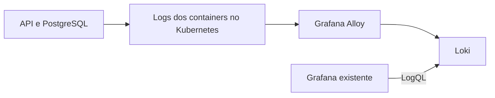

# O que a aplicação conta

[English](README.en.md) · Português

O painel de métricas ajuda a perceber que alguma coisa mudou. Os logs ajudam a investigar o que aconteceu. Neste laboratório, os registros da API de notas e do PostgreSQL chegam ao Loki e podem ser consultados no Grafana que já usamos no monitoring-lab.

O Alloy acompanha os Pods pela API do Kubernetes. Não há montagem de diretórios dos nós, contêiner privilegiado ou alteração na imagem da aplicação. A API já escreve seus acessos HTTP e erros no stdout/stderr pelo Gunicorn.



## Colocar para rodar

Use Docker, Git, Bash e Python 3 em Linux x86_64 ou WSL. Clone este projeto, [kubernetes-lab](https://github.com/tommmdl/kubernetes-lab) e [monitoring-lab](https://github.com/tommmdl/monitoring-lab) lado a lado.

Se ainda não tiver o ambiente, no Kubernetes lab execute `bash scripts/prepare.sh` e `bash scripts/lab.sh up`; depois, no monitoring-lab, execute `bash scripts/lab.sh up`. Se a aplicação e o Grafana já estão rodando, pule essa preparação. Evite reaplicar os manifestos da aplicação quando o Argo CD já estiver gerenciando seu estado.

Aqui no logging-lab:

```bash
bash scripts/validate.sh
bash scripts/lab.sh up
python3 tests/verify.py
```

Os scripts selecionam o contexto `kind-devops-notes` e usam o kubeconfig privado do Kubernetes lab. Para outro caminho, exporte `KUBERNETES_LAB_DIR`.

O Loki e o Alloy ficam em `logging-lab`. Uma Role e um RoleBinding em `notes-lab` permitem que a identidade do Alloy leia Pods e seus logs nesse namespace. Ela não pode ler Secrets nem logs de outros namespaces. A descoberta filtra os Pods `notes-api`, `notes-api-alpine`, `notes-db` e `notes-db-alpine`; as permissões de leitura de Pods e logs abrangem o namespace, não somente esses dois labels.

## Encontrar os logs

```bash
bash scripts/access.sh grafana
```

Abra http://localhost:8008/d/notes-logs. Se o túnel do monitoring-lab já está aberto nessa porta, use-o. O usuário continua sendo `admin`, com a mesma senha do Grafana:

```bash
bash scripts/k.sh -n monitoring-lab get secret grafana-admin -o jsonpath='{.data.password}' | base64 -d
```

O datasource **Notes Loki** e o painel **O que a aplicação conta / Application logs** são aplicados pela API do Grafana a partir dos JSONs em `grafana/`. O script é repetível e usa UIDs próprios. O datasource Prometheus e o painel de métricas continuam lá. Isso é diferente do provisionamento por arquivo do monitoring-lab: os registros deste projeto ficam na base persistente do Grafana e podem ser reaplicados com `python3 scripts/grafana.py apply`.

No Explore, selecione Notes Loki e experimente:

```logql
{namespace="notes-lab", app="notes-api"}
```

```logql
{namespace="notes-lab", app="notes-api"} |= "404"
```

```logql
{namespace="notes-lab", app=~"notes-db(-alpine)?"}
```

O painel também mostra linhas por segundo e uma contagem de respostas HTTP 4xx/5xx identificadas no formato de acesso atual do Gunicorn. Essa consulta depende desse formato e não é uma taxa de erro instrumentada na aplicação. Linhas de health check e das sondas de monitoramento também aparecem.

## Seguir uma mensagem de ponta a ponta

O teste faz um acesso válido e outro a uma URL inexistente, usando um marcador único. Ele espera esses registros aparecerem no Loki e consulta o mesmo marcador através do Grafana. O teste não envia linhas diretamente para o Loki. O 404 é esperado e não altera os dados da aplicação.

Depois, substitui o Pod do Loki e confere se os registros anteriores continuam consultáveis com o mesmo PVC. Também verifica os labels, os logs do banco, os recursos de métricas já existentes e as permissões do coletor. O teste pede ao PostgreSQL uma mensagem com `RAISE LOG`, sem alterar tabelas ou registros, e procura esse marcador nos logs do banco usando uma janela de 24 horas.

Os [resultados](docs/validation.md) guardam o que foi executado e os limites dessas verificações. A aplicação e seu banco não são reiniciados pelo teste. O Argo CD continua gerenciando a aplicação; este logging-lab é aplicado pelos scripts e ainda não é uma Application do Argo CD.

As mesmas **16 verificações passaram localmente e no GitHub Actions**, incluindo consultas pelo Grafana, troca do Pod do Loki e permissões de coleta.

## Guardar sem acumular para sempre

As imagens do Loki v3.7.8 e Alloy v1.20.1 estão fixadas por digest em `config/images.json`. O Loki usa TSDB, filesystem e um PVC local de 2 GiB. A retenção está configurada para 24 horas, com remoção assíncrona pelo compactor; ela não é um limite de tamanho do disco e não foi validada esperando um dia inteiro. O Alloy tem um PVC de 1 GiB para seu estado local.

É uma instalação de estudo, com uma réplica de cada componente, sem backup e sem garantia de entrega exatamente uma vez. Reinícios e interrupções podem causar perda ou repetição de linhas. O teste de troca de Pod valida o caso executado, não recuperação de desastre.

Os labels são namespace, app, Pod, container e job. O marcador da requisição fica no texto, sem virar label. Evite indexar IDs de usuário, tokens e URLs completas. Este projeto não faz mascaramento de dados sensíveis: não envie segredos em requisições ou mensagens de log. O coletor lê stdout/stderr; não coleta arquivos arbitrários, eventos do cluster ou logs de todos os namespaces.

O Loki não tem autenticação habilitada e fica como ClusterIP. Não exponha sua porta diretamente na internet. Para diagnóstico local, use `bash scripts/access.sh loki` e http://localhost:8009/ready. Os testes abrem túneis em portas temporárias, sem disputar as portas das telas.

## Remover este laboratório

```bash
bash scripts/lab.sh down
```

Isso remove somente o datasource e painel deste projeto no Grafana, suas permissões de coleta e o namespace `logging-lab`, incluindo os volumes e logs armazenados. A pasta vazia Logging Labs fica no Grafana. A aplicação, o PostgreSQL, o Argo CD e o monitoring-lab continuam nos seus namespaces. A remoção da integração exige que o Grafana esteja disponível; se estiver fora do ar, o script interrompe a remoção para permitir outra tentativa.

Os arquivos de `.local/` ficam fora do Git. A configuração e os testes foram feitos com ajuda do assistente. Entre os próximos passos estão logs estruturados, correlação com traces, mascaramento e armazenamento externo.

Referências: [coleta com Alloy](https://grafana.com/docs/alloy/latest/collect/logs-in-kubernetes/), [componente de leitura pela API](https://grafana.com/docs/alloy/latest/reference/components/loki/loki.source.kubernetes/) e [armazenamento do Loki](https://grafana.com/docs/loki/latest/configure/storage/).

## Seguir a requisição pelos traces

O [tracing-lab](https://github.com/tommmdl/tracing-lab) instrumenta a API com OpenTelemetry e acrescenta Tempo ao Grafana. As linhas JSON da aplicação passam a trazer trace IDs, permitindo encontrar os logs relacionados ao span sem transformar o ID em label.

Depois da adoção do PostgreSQL Alpine, a descoberta e a consulta do painel incluem os labels antigos e novos do banco. O teste escolhe o banco ativo pelo Service `postgres`, sem executar no StatefulSet Debian parado. [Evidências da migração](https://github.com/tommmdl/security-lab/blob/main/docs/postgres-adoption.md).

O [ensaio da API Alpine](https://github.com/tommmdl/security-lab/blob/main/docs/api-alpine.md) testa as imagens básica e instrumentada com scans completos, aplicação e tracing real por Collector/Tempo/Grafana/Loki. Usa workloads e bancos separados; os pins da API principal continuam iguais.
